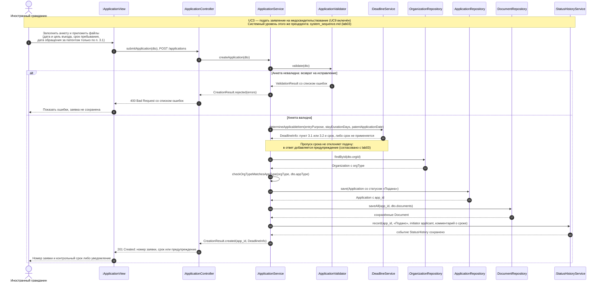

# Диаграмма последовательностей на уровне классов (lab04)

## 1. Выбранный прецедент

Для диаграммы последовательностей на уровне классов выбран один прецедент из `use_case.md`: **UC3 — Подать заявление на медосвидетельствование** с обязательным включением **UC9 — Выбрать медицинскую организацию**. Тот же прецедент на системном уровне (пользователь ↔ портал как чёрный ящик) раскрыт в `system_sequence.md` (lab03); данная диаграмма показывает, какие объекты классов приложения обмениваются сообщениями и какие методы вызываются при выполнении этого прецедента. Другие прецеденты (UC4, UC6, UC7, UC12, UC13) в диаграмму не входят.

## 2. Объекты классов и их обязанности

| Объект | Класс и обязанность |
| :--- | :--- |
| `:ApplicationView` | Граничный класс интерфейса: форма анкеты и список клиник (UC9), отправка DTO контроллеру, показ ответа заявителю. |
| `:ApplicationController` | Точка входа HTTP: принимает `POST /applications`, передаёт DTO сервису, возвращает ответ представления (400 с ошибками или 201 с номером заявки). |
| `:ApplicationService` | Оркестратор операции и граница транзакции: вызывает валидатор, сервис сроков, проверку типа организации и сохранение агрегата заявки. |
| `:ApplicationValidator` | Проверяет полноту и формат полей анкеты и вложений; возвращает список ошибок без обращения к БД. |
| `:DeadlineService` | Инкапсулирует правила раздела 3 дорожной карты: по цели въезда, сроку пребывания и дате обращения за патентом возвращает применимый пункт (3.1 или 3.2) и контрольный срок либо признак «срок не применяется». |
| `:OrganizationRepository` | Доступ к справочнику `ORGANIZATION`: выбор организации заявки для проверки типа. |
| `:ApplicationRepository` | Сохранение записи `APPLICATION` со статусом «Подана», возврат `app_id`. |
| `:DocumentRepository` | Сохранение приложенных файлов как записей `DOCUMENT`, привязанных к `app_id`. |
| `:StatusHistoryService` | Запись первого события истории `STATUS_HISTORY` (статус «Подано», инициатор — заявитель, комментарий о контрольном сроке). |

## 3. Ход выполнения

**Предусловие:** заявитель авторизован (UC1, UC2, UC8 из `use_case.md`); список медорганизаций получен ранее через UC9.

1. **Подготовка и отправка (шаги 1–3).** Заявитель заполняет анкету и прикладывает файлы; представление вызывает `submitApplication(dto)` контроллера, контроллер передаёт DTO в `createApplication(dto)` сервиса.
2. **Валидация (шаг 4).** Сервис вызывает `validate(dto)` валидатора; это проверка корректности заполнения, а не сроков.
3. **Возврат на исправление (шаги 5–8).** При ошибках валидатор возвращает список, сервис и контроллер передают его представлению, заявитель видит ошибки; заявка не сохраняется и может быть подана повторно после исправления.
4. **Определение пункта и срока (шаги 9–10).** `DeadlineService` применяет правила п. 3.1 (трудовая цель: 30 дней со дня въезда или обращение за патентом/разрешением) и п. 3.2 (иная цель при пребывании более 90 суток: 90 дней); если ни один пункт не применим, возвращает признак «срок не применяется». Пропуск срока не отклоняет подачу: в ответ добавляется предупреждение, как согласовано в lab03.
5. **Проверка типа организации (шаги 11–13).** Сервис загружает организацию заявки и методом `checkOrgTypeMatchesAppType` применяет бизнес-ограничение из `er.md`: медицинской заявке соответствует только медицинская организация, заявке на полис только страховая.
6. **Сохранение агрегата (шаги 14–19).** Сервис сохраняет `APPLICATION` со статусом «Подана», затем файлы в `DOCUMENT` и записывает событие в `STATUS_HISTORY` через `StatusHistoryService`; все три записи выполняются в одной транзакции сервиса.
7. **Ответ заявителю (шаги 20–22).** Сервис возвращает результат создания, контроллер отдаёт 201 Created с номером заявки и контрольным сроком либо предупреждением о пропуске срока или об отсутствии срока; представление показывает результат заявителю. Это завершение UC3.

## 4. Отказ, возврат на исправление и сроки

- **Ошибки анкеты** — единственная причина отказа на этом этапе: транзакция не открывается, записи не создаются, заявитель получает список ошибок и подаёт заявление повторно.
- **Пропуск контрольного срока** не является отказом (п. 3.1–3.2 задают сроки, но не отказ из-за просрочки): заявка сохраняется, в ответ и в комментарий истории добавляется предупреждение.
- **Срок не применяется**, если анкета не подпадает ни под п. 3.1, ни под п. 3.2: заявка сохраняется без контрольного срока.
- Согласованность с lab03: те же три исхода по сроку и тот же возврат на исправление, но раскрытые через вызовы методов объектов классов.

## 5. Связь с `use_case.md` и `er.md`

- Прецедент UC3 с включением UC9 и предусловие авторизации взяты из `use_case.md` без изменений.
- Репозитории соответствуют сущностям `er.md`: `OrganizationRepository` ↔ `ORGANIZATION`, `ApplicationRepository` ↔ `APPLICATION`, `DocumentRepository` ↔ `DOCUMENT`, `StatusHistoryService` ↔ `STATUS_HISTORY`.
- Поля DTO совпадают с атрибутами `APPLICATION`: `org_id`, `entry_date`, `entry_purpose`, `stay_duration_days`, `patent_application_date` (заполняется только при обращении по п. 3.1, иначе пусто).
- Проверка типа организации реализует ограничение целостности из раздела 2.1 `er.md` (`EMPLOYEE.org_id = APPLICATION.org_id` для действий сотрудников и соответствие `org_type` типу заявки при подаче).