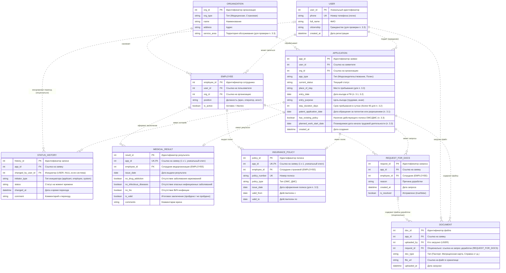

## 1. Границы предметной области

ER-диаграмма описывает логическую модель предметной области (основные бизнес-сущности, их атрибуты и связи) для «Портала медицинского освидетельствования и страхования» (раздел 3 дорожной карты), на основе которой строится хранилище данных приложения.

## 2. Сущности и атрибуты

| Сущность | Описание |
| :--- | :--- |
| **USER (Пользователь)** | Единая таблица всех физических лиц (иностранных граждан и сотрудников организаций). Хранит уникальный номер телефона для авторизации по SMS, ФИО и гражданство (используется для проверки условий п. 3.3). Собственный суррогатный PK (`user_id`). |
| **ORGANIZATION (Организация)** | Справочник медицинских организаций (п. 3.1, 3.2) и страховых компаний по месту пребывания (п. 3.3). Поле `service_area` позволяет проверять совпадение с `place_of_stay` заявителя без строгой привязки к фактическому адресу офиса. Собственный PK (`org_id`). |
| **EMPLOYEE (Сотрудник)** | Промежуточная сущность между `USER` и `ORGANIZATION`. Определяет роль сотрудника (врач, оператор, страховой агент) и его привязку к конкретной организации. Собственный суррогатный PK (`employee_id`), внешние ключи `user_id` и `org_id` в состав PK не входят, поэтому связи с `USER` и `ORGANIZATION` неидентифицирующие. |
| **APPLICATION (Заявка)** | Центральная сущность процесса. Связывает заявителя и организацию, хранит тип услуги (`app_type`), текущий статус и анкетные данные для проверки применимости пунктов 3.1–3.3 и контроля сроков (`place_of_stay`, `entry_date`, `entry_purpose`, `stay_duration_days`, `patent_application_date`, `has_existing_policy`, `planned_work_start_date`). Собственный суррогатный PK (`app_id`), все входящие FK в состав PK не входят. |
| **STATUS_HISTORY (История статусов)** | Журнал всех изменений статуса заявки. Поле `initiator_type` указывает, кто инициировал переход (`applicant` — заявитель, `employee` — сотрудник, `system` — автоматическое событие системы), а опциональный внешний ключ `changed_by_user_id` ссылается на конкретного пользователя (либо равен `NULL` для системных переходов). Собственный суррогатный PK (`history_id`). |
| **MEDICAL_RESULT (Результат медосвидетельствования)** | Итоговое заключение медорганизации. Поле `app_id` имеет ограничение `UNIQUE` (`UK,FK`), что физически гарантирует отношение 1:1 к заявке. Фиксирует результаты проверок на отсутствие наркомании, инфекционных заболеваний, представляющих опасность для окружающих, и ВИЧ-инфекции, а также дату выдачи и итоговый статус. Собственный суррогатный PK (`result_id`). |
| **INSURANCE_POLICY (Страховой полис)** | Выпущенный полис ОМС или ДМС с уникальным номером, датой оформления (`issue_date`) и сроком действия. Поле `app_id` имеет ограничение `UNIQUE` (`UK,FK`), что гарантирует отношение 1:1 к заявке. Собственный суррогатный PK (`policy_id`). |
| **REQUEST_FOR_DOCS (Запрос доработки)** | Запрос сотрудника на предоставление дополнительных документов или исправление данных в заявке с указанием причины и флага выполнения. Собственный суррогатный PK (`request_id`). Пара `(request_id, app_id)` снабжена ограничением `UNIQUE`: оно необходимо, чтобы составной внешний ключ `DOCUMENT(request_id, app_id)` мог ссылаться на таблицу запросов и тем самым гарантировать принадлежность файла и запроса одной заявке. |
| **DOCUMENT (Документ)** | Файлы, прикреплённые к заявке при первичной подаче (`request_id = NULL`) или догруженные в ответ на конкретный запрос доработки (`request_id` ссылается на `REQUEST_FOR_DOCS`). **Ограничение целостности:** файл не может быть прикреплён к запросу по другой заявке. Это гарантируется составным внешним ключом `FOREIGN KEY (request_id, app_id) REFERENCES REQUEST_FOR_DOCS(request_id, app_id)`. Собственный суррогатный PK (`doc_id`). |

### 2.1. Бизнес-ограничения целостности
Для обеспечения согласованности данных устанавливается следующее бизнес-ограничение: сотрудник, выполняющий действие по заявке, должен принадлежать той же организации, к которой направлена эта заявка.

Таким образом, для всех связанных записей должно выполняться условие:

`EMPLOYEE.org_id = APPLICATION.org_id`

Это правило распространяется на следующие сущности:

- **MEDICAL_RESULT:** сотрудник медицинской организации, оформивший заключение (`employee_id`), должен принадлежать организации, указанной в соответствующей заявке (`app_id`).
- **INSURANCE_POLICY:** сотрудник страховой компании, выдавший полис (`employee_id`), должен принадлежать организации, указанной в соответствующей заявке (`app_id`).
- **REQUEST_FOR_DOCS:** сотрудник, направивший запрос на доработку (`employee_id`), должен принадлежать организации, обрабатывающей соответствующую заявку (`app_id`).

При проверке ограничения организация сотрудника определяется через `EMPLOYEE.org_id`, а организация заявки — через `APPLICATION.org_id`. Сопоставление выполняется по связанным записям через `employee_id` и `app_id`.

Данное ограничение является бизнес-правилом целостности данных и дополняет существующие внешние ключи. Оно предотвращает ситуации, когда заключение, полис или запрос на доработку по заявке одной организации оформляется сотрудником другой организации.

## 3. Семантика связей (Кардинальность)

Все связи модели **неидентифицирующие** и показаны пунктирной линией (`..`): ни в одной дочерней сущности внешний ключ не входит в состав первичного ключа, у каждой таблицы собственный суррогатный PK. Идентифицирующих связей (сплошных линий) в модели нет. Обязательность и кратность участия выражаются только символами на концах линии: `||` — ровно один (FK NOT NULL), `|o` — ноль или один (FK допускает `NULL`), `o{` — ноль или много, `o|` — ноль или один экземпляр дочерней сущности.

* `USER ||..o{ EMPLOYEE` — неидентифицирующая. Маркер `||`: каждая запись `EMPLOYEE` ссылается ровно на одного пользователя (`user_id` NOT NULL). Маркер `o{`: у пользователя может быть ноль или несколько записей о трудоустройстве.
* `ORGANIZATION ||..o{ EMPLOYEE` — неидентифицирующая. Маркер `||`: каждый сотрудник состоит ровно в одной организации (`org_id` NOT NULL). Маркер `o{`: у организации может быть ноль или много сотрудников.
* `USER ||..o{ APPLICATION` — неидентифицирующая. Маркер `||`: каждая заявка подана ровно одним заявителем (`user_id` NOT NULL). Маркер `o{`: пользователь может подать ноль или несколько заявок.
* `ORGANIZATION ||..o{ APPLICATION` — неидентифицирующая. Маркер `||`: каждая заявка направлена ровно в одну организацию (`org_id` NOT NULL). Маркер `o{`: организация обрабатывает ноль или много заявок.
* `APPLICATION ||..o{ STATUS_HISTORY` — неидентифицирующая. Маркер `||`: каждая запись истории относится ровно к одной заявке (`app_id` NOT NULL). Маркер `o{`: у заявки ноль или много записей истории.
* `USER |o..o{ STATUS_HISTORY` — неидентифицирующая. Маркер `|o`: запись истории может не иметь пользователя-инициатора (`changed_by_user_id` допускает `NULL` для системных переходов). Маркер `o{`: пользователь может инициировать ноль или много переходов.
* `APPLICATION ||..o| MEDICAL_RESULT` — неидентифицирующая. Маркер `||`: каждое заключение ссылается ровно на одну заявку (`app_id` NOT NULL). Маркер `o|`: у заявки не более одного заключения (только при `app_type = 'medical'`; для заявок на полис результат отсутствует).
* `EMPLOYEE ||..o{ MEDICAL_RESULT` — неидентифицирующая. Маркер `||`: каждое заключение оформлено ровно одним сотрудником (`employee_id` NOT NULL). Маркер `o{`: сотрудник может оформить ноль или много заключений.
* `APPLICATION ||..o| INSURANCE_POLICY` — неидентифицирующая. Маркер `||`: каждый полис ссылается ровно на одну заявку (`app_id` NOT NULL). Маркер `o|`: у заявки не более одного полиса (только при `app_type = 'insurance'`; для медицинских заявок полис отсутствует).
* `EMPLOYEE ||..o{ INSURANCE_POLICY` — неидентифицирующая. Маркер `||`: каждый полис выдан ровно одним сотрудником (`employee_id` NOT NULL). Маркер `o{`: сотрудник может выдать ноль или много полисов.
* `APPLICATION ||..o{ REQUEST_FOR_DOCS` — неидентифицирующая. Маркер `||`: каждый запрос относится ровно к одной заявке (`app_id` NOT NULL). Маркер `o{`: по заявке может быть ноль или несколько запросов.
* `EMPLOYEE ||..o{ REQUEST_FOR_DOCS` — неидентифицирующая. Маркер `||`: каждый запрос направлен ровно одним сотрудником (`employee_id` NOT NULL). Маркер `o{`: сотрудник может направить ноль или много запросов.
* `APPLICATION ||..o{ DOCUMENT` — неидентифицирующая. Маркер `||`: каждый файл прикреплён ровно к одной заявке (`app_id` NOT NULL). Маркер `o{`: у заявки ноль или много файлов (ноль — только на этапе черновика до прикрепления файлов).
* `USER ||..o{ DOCUMENT` — неидентифицирующая. Маркер `||`: каждый файл загружен ровно одним пользователем (`uploaded_by` NOT NULL). Маркер `o{`: пользователь может загрузить ноль или много файлов.
* `REQUEST_FOR_DOCS |o..o{ DOCUMENT` — неидентифицирующая. Маркер `|o`: файл может не относиться ни к одному запросу доработки (`request_id` допускает `NULL` для файлов первичной подачи). Маркер `o{`: к одному запросу может относиться ноль или много файлов. **Ограничение целостности:** при заполненном `request_id` значение `app_id` в `DOCUMENT` обязано совпадать со значением `app_id` в связанной записи `REQUEST_FOR_DOCS` — это обеспечивается составным внешним ключом `(request_id, app_id)`.

## 4. Соответствие сценариям из `use_case.md`

1. **Авторизация и роли (`UC1`, `UC2`, `UC8`):** все участники регистрируются и входят по номеру телефона (`USER.phone`). Принадлежность к роли сотрудника медорганизации или страховой определяется через `EMPLOYEE` и `ORGANIZATION.org_type`.
2. **Медосвидетельствование (`UC3`, `UC9`, `UC4`, `UC7`):** гражданин выбирает медорганизацию и создаёт `APPLICATION` (`app_type = 'medical'`), что фиксируется в `STATUS_HISTORY` с `initiator_type = 'applicant'`. Сотрудник медорганизации загружает `MEDICAL_RESULT` и обновляет статус (`initiator_type = 'employee'`).
3. **Страхование (`UC5`, `UC11`, `UC10`, `UC14`):** гражданин выбирает страховую компанию и создаёт `APPLICATION` (`app_type = 'insurance'`). Сотрудник страховой оформляет `INSURANCE_POLICY`.
4. **Доработка и история статусов (`UC6`, `UC12`, `UC13`):** при выявлении ошибок сотрудник создаёт `REQUEST_FOR_DOCS` и переводит заявку на доработку. По запросу сотрудника гражданин может исправить данные самой заявки (анкеты) и/или загрузить недостающие файлы (`DOCUMENT` с заполненным `request_id`). Повторная отправка фиксируется в `STATUS_HISTORY` с указанием `changed_by_user_id` заявителя и `initiator_type = 'applicant'`.

## 5. Поддержка правил и сроков из дорожной карты (Раздел 3)

Применимость услуг и контроль сроков определяются строго по условиям пунктов 3.1–3.3 без дополнительных исключений:

* **Пункт 3.1 — Медицинское освидетельствование (трудовая деятельность):**
  * *Условие включения:* иностранный гражданин прибыл в РФ в целях осуществления трудовой деятельности (`APPLICATION.entry_purpose = 'трудовая'`).
  * *Срок:* в течение **30 календарных дней со дня въезда** (`APPLICATION.entry_date`), **либо при обращении с заявлением об оформлении патента или разрешения на работу** (срок контролируется по дате `APPLICATION.patent_application_date`).
  * *Результат:* заключение в `MEDICAL_RESULT` об отсутствии наркомании, опасных инфекционных заболеваний и ВИЧ.
* **Пункт 3.2 — Медицинское освидетельствование (длительное пребывание без трудовой деятельности):**
  * *Условие включения:* иностранный гражданин прибыл на длительный период **более 90 суток** (`APPLICATION.stay_duration_days > 90`) в целях, **иных от осуществления трудовой деятельности** (`APPLICATION.entry_purpose = 'иная'`).
  * *Срок:* в течение **90 календарных дней со дня въезда** (`APPLICATION.entry_date`).
  * *Результат:* аналогичное заключение в `MEDICAL_RESULT`.
* **Пункт 3.3 — Полис ОМС или ДМС:**
  * *Условие включения:* гражданство заявителя (`USER.citizenship`) — Азербайджан, Таджикистан, Узбекистан, Молдова, Украина, Киргизия, Казахстан или Армения **при отсутствии действующего полиса** (`APPLICATION.has_existing_policy = false`), если полис необходим для трудоустройства.
  * *Срок и место:* **до начала трудовой деятельности** (контролируется путем сравнения `INSURANCE_POLICY.issue_date` и `APPLICATION.planned_work_start_date`), при этом проверяется совпадение `APPLICATION.place_of_stay` с территорией обслуживания выбранной страховой компании (`ORGANIZATION.service_area`).
  * *Результат:* оформленный полис ОМС или ДМС в `INSURANCE_POLICY`, выданный страховой компанией по месту пребывания.