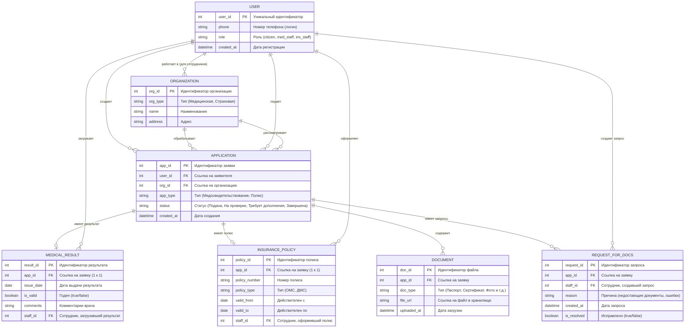

## 1. Границы предметной области

ER-диаграмма отражает структуру базы данных для портала, автоматизирующего процессы медицинского освидетельствования и страхования. Модель охватывает учет пользователей (граждан и сотрудников организаций), процесс подачи и обработки заявок, а также хранение результатов освидетельствования, полисов и прикрепленных документов.

## 2. Сущности и атрибуты

| Сущность | Описание |
| :--- | :--- |
| **USER (Пользователь)** | Единая таблица для всех акторов. Атрибут `role` разграничивает права доступа (гражданин, сотрудник медорганизации, сотрудник страховой). |
| **ORGANIZATION (Организация)** | Справочник медицинских учреждений и страховых компаний, с которыми взаимодействует система. |
| **APPLICATION (Заявка)** | Центральная сущность. Связывает пользователя и организацию, фиксирует тип услуги (медицина или страхование) и текущий статус обработки. |
| **DOCUMENT (Документ)** | Файлы, прикрепленные гражданином к заявке (сканы паспорта, сертификаты, фотографии 3x4 и т.д.). |
| **MEDICAL_RESULT (Результат медосвидетельствования)** | Сущность, которая создается по завершении проверки медорганизацией. Содержит заключение о годности. |
| **INSURANCE_POLICY (Страховой полис)** | Сущность, создаваемая страховой компанией. Содержит номер полиса, срок действия и тип (ОМС/ДМС). |
| **REQUEST_FOR_DOCS (Запрос документов)** | Сущность, фиксирующая факт того, что сотрудник нашел ошибки и вернул заявку на доработку гражданину. |

## 3. Семантика связей (Кардинальность)

*   `USER ||--o{ APPLICATION` — **Один-ко-многим**. Один гражданин может подать множество заявок (на разные клиники или страховые).
*   `ORGANIZATION ||--o{ APPLICATION` — **Один-ко-многим**. Одна организация обрабатывает множество заявок от разных граждан.
*   `APPLICATION ||--o| MEDICAL_RESULT` — **Один-к-одному (или ноль)**. У заявки на медосвидетельствование может быть только один итоговый результат (или он еще не создан).
*   `APPLICATION ||--o| INSURANCE_POLICY` — **Один-к-одному (или ноль)**. У заявки на полис может быть только один выпущенный полис.
*   `APPLICATION ||--o{ DOCUMENT` — **Один-ко-многим**. К одной заявке можно прикрепить несколько файлов.
*   `APPLICATION ||--o{ REQUEST_FOR_DOCS` — **Один-ко-многим**. По одной заявке сотрудник может сделать несколько запросов на исправление, пока она не будет завершена.

## 4. Соответствие бизнес-логике

Данная структура полностью поддерживает сценарии, описанные в диаграмме прецедентов:

1.  **Медосвидетельствование (п. 3.1, 3.2):** Гражданин создает `APPLICATION` (тип `medical`), прикрепляет `DOCUMENT`. Сотрудник медорганизации обрабатывает её и создает `MEDICAL_RESULT`.
2.  **Страхование (п. 3.3):** Гражданин создает `APPLICATION` (тип `insurance`). Сотрудник страховой создает `INSURANCE_POLICY`.
3.  **Доработка:** Если сотрудник находит ошибки, создается `REQUEST_FOR_DOCS`. Статус `APPLICATION` меняется на "Требует дополнения", и гражданин может загрузить новые `DOCUMENT`.