```mermaid
erDiagram
    USER ||--o{ EMPLOYEE : "может являться"
    ORGANIZATION ||--o{ EMPLOYEE : "нанимает"

    USER ||--o{ APPLICATION : "подает (гражданин)"
    ORGANIZATION ||--o{ APPLICATION : "обрабатывает"

    APPLICATION ||--o{ STATUS_HISTORY : "имеет историю"
    APPLICATION ||--o| MEDICAL_RESULT : "имеет результат"
    APPLICATION ||--o| INSURANCE_POLICY : "имеет полис"
    APPLICATION ||--o{ DOCUMENT : "содержит файлы"
    APPLICATION ||--o{ REQUEST_FOR_DOCS : "имеет запросы"

    %% Уточненные связи с сотрудниками и пользователями
    EMPLOYEE ||--o{ STATUS_HISTORY : "изменил статус"
    USER ||--o{ DOCUMENT : "загрузил файл"
    EMPLOYEE ||--o{ MEDICAL_RESULT : "оформил заключение"
    EMPLOYEE ||--o{ INSURANCE_POLICY : "выдал полис"
    EMPLOYEE ||--o{ REQUEST_FOR_DOCS : "направил запрос"

    USER {
        int user_id PK "Уникальный идентификатор"
        string phone "Номер телефона (логин)"
        string full_name "ФИО"
        datetime created_at "Дата регистрации"
    }

    ORGANIZATION {
        int org_id PK "Идентификатор организации"
        string org_type "Тип (Медицинская, Страховая)"
        string name "Наименование"
        string address "Адрес"
    }

    EMPLOYEE {
        int employee_id PK "Идентификатор сотрудника"
        int user_id FK "Ссылка на пользователя"
        int org_id FK "Ссылка на организацию"
        string position "Должность (врач, оператор, агент)"
        boolean is_active "Активен / Уволен"
    }

    APPLICATION {
        int app_id PK "Идентификатор заявки"
        int user_id FK "Ссылка на заявителя"
        int org_id FK "Ссылка на организацию"
        string app_type "Тип (Медосвидетельствование, Полис)"
        string current_status "Текущий статус"
        datetime created_at "Дата создания"
    }

    STATUS_HISTORY {
        int history_id PK "Идентификатор записи"
        int app_id FK "Ссылка на заявку"
        int employee_id FK "Кто изменил (EMPLOYEE)"
        string status "Статус на момент времени"
        datetime changed_at "Дата и время перехода"
        string comment "Комментарий к переходу"
    }

    MEDICAL_RESULT {
        int result_id PK "Идентификатор результата"
        int app_id FK "Ссылка на заявку (1 к 1)"
        int employee_id FK "Сотрудник (EMPLOYEE)"
        date issue_date "Дата выдачи результата"
        boolean is_valid "Годен (true/false)"
        string comments "Комментарии врача"
    }

    INSURANCE_POLICY {
        int policy_id PK "Идентификатор полиса"
        int app_id FK "Ссылка на заявку (1 к 1)"
        int employee_id FK "Сотрудник (EMPLOYEE)"
        string policy_number "Номер полиса"
        string policy_type "Тип (ОМС, ДМС)"
        date valid_from "Действителен с"
        date valid_to "Действителен по"
    }

    REQUEST_FOR_DOCS {
        int request_id PK "Идентификатор запроса"
        int app_id FK "Ссылка на заявку"
        int employee_id FK "Сотрудник (EMPLOYEE)"
        string reason "Причина доработки"
        datetime created_at "Дата запроса"
        boolean is_resolved "Исправлено (true/false)"
    }

    DOCUMENT {
        int doc_id PK "Идентификатор файла"
        int app_id FK "Ссылка на заявку"
        int uploaded_by FK "Кто загрузил (USER)"
        int request_id FK "Опционально: ссылка на запрос доработки"
        string doc_type "Тип (Паспорт, Справка и т.д.)"
        string file_url "Ссылка на файл в хранилище"
        datetime uploaded_at "Дата загрузки"
    }
```

## 1. Границы предметной области

ER-диаграмма отражает структуру базы данных для портала, автоматизирующего процессы медицинского освидетельствования и страхования. Модель охватывает учет пользователей, разграничение их ролей через сущность трудоустройства, процесс подачи и обработки заявок, хранение полной истории изменения статусов, а также результаты освидетельствования, полисы и прикрепленные документы.

## 2. Сущности и атрибуты

| Сущность | Описание |
| :--- | :--- |
| **USER (Пользователь)** | Единая таблица для всех физических лиц. Содержит базовые данные (телефон, ФИО). |
| **ORGANIZATION (Организация)** | Справочник медицинских учреждений и страховых компаний. |
| **EMPLOYEE (Сотрудник)** | Промежуточная сущность, реализующая связь «Многие-ко-многим» между `USER` и `ORGANIZATION`. Позволяет одному человеку работать в нескольких местах, а одной организации иметь много сотрудников. |
| **APPLICATION (Заявка)** | Центральная сущность. Связывает гражданина и организацию, фиксирует тип услуги и текущий статус. |
| **STATUS_HISTORY (История статусов)** | Сущность для аудита. Хранит лог всех изменений статуса заявки с датами, сотрудником (кто изменил) и комментариями. |
| **DOCUMENT (Документ)** | Файлы, прикрепленные к заявке. Содержит ссылку на пользователя, который их загрузил. |
| **MEDICAL_RESULT (Результат медосвидетельствования)** | Создается сотрудником медорганизации по завершении проверки. |
| **INSURANCE_POLICY (Страховой полис)** | Создается сотрудником страховой компании. |
| **REQUEST_FOR_DOCS (Запрос документов)** | Фиксирует факт того, что сотрудник нашел ошибки и вернул заявку на доработку. |

## 3. Семантика связей (Кардинальность)

*   `USER ||--o{ EMPLOYEE` — **Один-ко-многим**. Один пользователь может иметь несколько записей о трудоустройстве (в разных организациях).
*   `ORGANIZATION ||--o{ EMPLOYEE` — **Один-ко-многим**. Одна организация нанимает множество сотрудников.
*   `USER ||--o{ APPLICATION` — **Один-ко-многим**. Один гражданин может подать множество заявок.
*   `ORGANIZATION ||--o{ APPLICATION` — **Один-ко-многим**. Одна организация обрабатывает множество заявок.
*   `APPLICATION ||--o{ STATUS_HISTORY` — **Один-ко-многим**. У одной заявки может быть множество записей об изменении статуса.
*   `EMPLOYEE ||--o{ STATUS_HISTORY` — **Один-ко-многим**. Конкретный сотрудник может изменить множество статусов.
*   `APPLICATION ||--o| MEDICAL_RESULT` — **Один-к-одному (или ноль)**. У заявки на медосвидетельствование может быть только один итоговый результат.
*   `EMPLOYEE ||--o{ MEDICAL_RESULT` — **Один-ко-многим**. Сотрудник может оформить множество заключений.
*   `APPLICATION ||--o| INSURANCE_POLICY` — **Один-к-одному (или ноль)**. У заявки на полис может быть только один выпущенный полис.
*   `EMPLOYEE ||--o{ INSURANCE_POLICY` — **Один-ко-многим**. Сотрудник страховой может выдать множество полисов.
*   `APPLICATION ||--o{ DOCUMENT` — **Один-ко-многим**. К одной заявке можно прикрепить несколько файлов.
*   `USER ||--o{ DOCUMENT` — **Один-ко-многим**. Пользователь может загрузить множество документов (связь по полю `uploaded_by`).
*   `APPLICATION ||--o{ REQUEST_FOR_DOCS` — **Один-ко-многим**. По одной заявке сотрудник может сделать несколько запросов на исправление.
*   `EMPLOYEE ||--o{ REQUEST_FOR_DOCS` — **Один-ко-многим**. Сотрудник может направить множество запросов на доработку.

## 4. Соответствие бизнес-логике

Данная структура полностью поддерживает сценарии, описанные в диаграмме прецедентов:

1.  **Медосвидетельствование (п. 3.1, 3.2):** Гражданин (`USER`) создает `APPLICATION` (тип `medical`), прикрепляет `DOCUMENT`. Сотрудник медорганизации (`EMPLOYEE`) обрабатывает её и создает `MEDICAL_RESULT`.
2.  **Страхование (п. 3.3):** Гражданин создает `APPLICATION` (тип `insurance`). Сотрудник страховой (`EMPLOYEE`) создает `INSURANCE_POLICY`.
3.  **Доработка и аудит:** Если сотрудник находит ошибки, создается `REQUEST_FOR_DOCS`. При любом изменении статуса в `APPLICATION` обновляется поле `current_status`, а в таблицу `STATUS_HISTORY` добавляется запись с датой, ID сотрудника (`employee_id`) и комментарием. Гражданин может загрузить новые `DOCUMENT` для исправления.