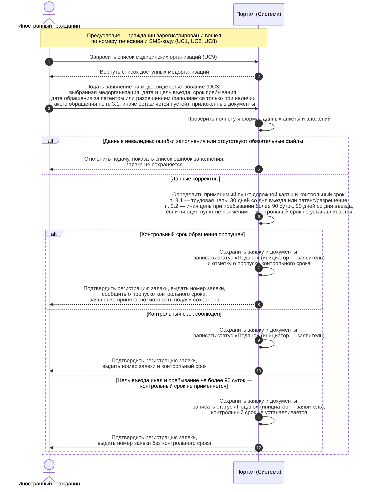

# Системная диаграмма последовательностей

## 1. Выбранный прецедент

Для системной диаграммы последовательностей выбран один прецедент из `use_case.md`: **UC3 — Подать заявление на медосвидетельствование** с обязательным включением **UC9 — Выбрать медицинскую организацию**. Диаграмма раскрывает получение услуги от запроса списка клиник до результата подачи.

Самостоятельные цели других этапов и других акторов в диаграмму не входят: UC4 (загрузка заключения сотрудником медорганизации), UC6 и UC7 (просмотр истории и получение результата гражданином), UC12 и UC13 (запрос исправлений и дополнение заявления) описаны в `use_case.md` как отдельные прецеденты и раскрываются другими диаграммами проекта. Успешная ветвь UC3 завершается выдачей номера заявки, как требует задание lab03. Для анкет, к которым не применим ни п. 3.1, ни п. 3.2, в диаграмме явно предусмотрен исход «контрольный срок не применяется».

## 2. Участники взаимодействия

Системная диаграмма показывает взаимодействие пользователя с системой, поэтому портал представлен как «чёрный ящик» без внутренних компонентов; состав участников соответствует `use_case.md`.

| Участник | Роль в сценарии |
| :--- | :--- |
| **Иностранный гражданин** | Запрашивает список медицинских организаций (UC9), выбирает клинику, заполняет и подаёт заявление (UC3), получает результат подачи: список ошибок, либо номер заявки с контрольным сроком, либо номер заявки с сообщением о пропуске срока, либо номер заявки без контрольного срока. |
| **Портал (Система)** | «Портал медицинского освидетельствования и страхования» из `use_case.md`. Возвращает справочник медорганизаций, проверяет полноту и формат анкеты и вложений, определяет применимый пункт дорожной карты и контрольный срок либо фиксирует, что контрольный срок не устанавливается, сохраняет заявку, документы и первое событие истории статусов, выдаёт номер заявки. |

Сотрудник медорганизации в этом сценарии не участвует: его действия (UC4, UC12) относятся к другим прецедентам и начинаются после подачи заявки.

## 3. Описание этапов взаимодействия

**Предусловие:** гражданин зарегистрирован и вошёл в систему по номеру телефона и SMS-коду (UC1, UC2, UC8 из `use_case.md`).

1. **Выбор медицинской организации (шаги 1–2).** Гражданин запрашивает справочник медорганизаций (UC9) и получает список доступных клиник. Выбор клиники является обязательным включением в подачу заявления.
2. **Подача заявления (шаг 3).** Гражданин подаёт заявление (UC3), указывая выбранную медорганизацию, дату и цель въезда, срок пребывания и приложенные документы. Дата обращения за патентом или разрешением на работу заполняется только при наличии такого обращения по п. 3.1; заявитель, чья ситуация описывается п. 3.2, оставляет это поле пустым.
3. **Формальная проверка (шаг 4).** Система проверяет полноту и формат данных анкеты и вложений. Это проверка корректности заполнения, а не сроков.
4. **Ошибки заполнения (шаг 5).** Если поля заполнены с ошибками или не приложены обязательные файлы, система отклоняет подачу и показывает список ошибок. Заявка не сохраняется; гражданин может исправить данные и подать заявление повторно.
5. **Определение применимого пункта и контрольного срока (шаг 6).** При корректных данных система определяет применимый пункт раздела 3 дорожной карты и контрольный срок: **п. 3.1** (цель въезда — трудовая деятельность) — 30 календарных дней со дня въезда либо обращение при подаче заявления о патенте или разрешении на работу; **п. 3.2** (иная цель въезда при пребывании более 90 суток) — 90 календарных дней со дня въезда. Если цель въезда иная и срок пребывания не более 90 суток, ни п. 3.1, ни п. 3.2 срок не задают — контрольный срок не устанавливается.
6. **Пропуск контрольного срока (шаги 7–8).** Пункты 3.1–3.2 задают сроки обращения, но не устанавливают отказ в услуге из-за просрочки, поэтому пропуск срока не отклоняет подачу. Система сохраняет заявку и документы, записывает статус «Подано» (инициатор — заявитель) и отметку о пропуске срока, выдаёт номер заявки и сообщает заявителю о пропуске контрольного срока. Возможность подачи сохранена: заявление принято в работу портала.
7. **Контрольный срок соблюдён (шаги 9–10).** Система сохраняет заявку и документы, записывает статус «Подано» (инициатор — заявитель) и подтверждает регистрацию заявки: гражданин получает номер заявки и контрольный срок.
8. **Контрольный срок не применяется (шаги 11–12).** При иной цели въезда и пребывании не более 90 суток включительно ни п. 3.1, ни п. 3.2 не задают срок обращения. Система сохраняет заявку и документы, записывает статус «Подано» (инициатор — заявитель) без контрольного срока и выдаёт номер заявки с пометкой, что контрольный срок по пунктам 3.1–3.2 не устанавливается. Это завершение прецедента UC3 во всех трёх исходах.

## 4. Отражение сроков и возвратов

- **Ошибки заполнения** — единственная причина отклонения подачи на этом этапе: заявка не сохраняется, гражданин получает список ошибок и может подать заявление повторно.
- **Пропуск контрольного срока** не является отказом в услуге: система уведомляет заявителя о просрочке, принимает заявление и сохраняет возможность подачи, фиксируя отметку о пропуске срока вместе со статусом «Подано».
- **Контрольный срок не применяется**, если анкета не подпадает ни под п. 3.1, ни под п. 3.2 (иная цель въезда при пребывании не более 90 суток): заявка принимается без контрольного срока, поскольку дорожная карта не устанавливает его для такой ситуации.
- **Соблюдение срока** завершается выдачей номера заявки и контрольного срока; дальнейшие этапы услуги (проверка сотрудником, заключение, просмотр истории) относятся к прецедентам UC4, UC6, UC7 и в эту диаграмму не входят.
- **История статусов:** сохранение заявки создаёт первую запись в `STATUS_HISTORY` из `er.md` со статусом «Подано» и инициатором «заявитель»; отметка о пропуске срока или об отсутствии контрольного срока сохраняется в комментарии к этому событию.