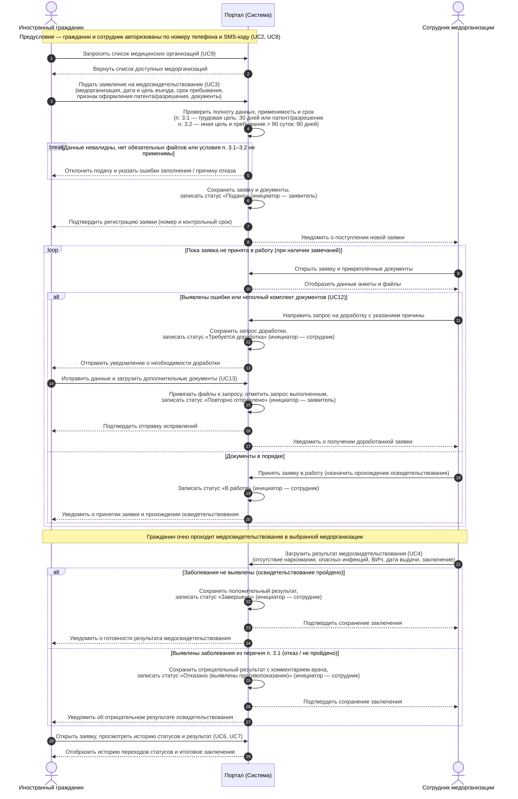

## 1. Выбранный прецедент (Use Case)

Для системной диаграммы последовательностей выбран сквозной сценарий **«Подача заявления и получение результата медицинского освидетельствования»** (пункты **3.1** и **3.2** раздела 3 дорожной карты). Он раскрывает путь услуги от запроса до результата и объединяет связанные прецеденты из `use_case.md`:

* **UC3** — Подать заявление на медосвидетельствование (с обязательным включением **UC9** — Выбрать медицинскую организацию);
* **UC12** — Запросить дополнительные документы или исправления (расширение `UC4`);
* **UC13** — Дополнить заявление по запросу;
* **UC4** — Загрузить результат медосвидетельствования;
* **UC6** — Просмотреть статус и историю заявки;
* **UC7** — Получить результат медосвидетельствования.

## 2. Участники взаимодействия

Внутренние классы приложения на системной диаграмме не отображаются — система представлена как «чёрный ящик», взаимодействующий с внешними акторами из `use_case.md`:

| Участник | Роль в сценарии |
| :--- | :--- |
| **Иностранный гражданин** | Выбирает медорганизацию, подаёт заявление и документы, при необходимости дорабатывает заявку по запросу сотрудника, отслеживает историю статусов и получает итоговое заключение. |
| **Портал (Система)** | «Портал медицинского освидетельствования и страхования». Проверяет корректность анкеты, применимость п. 3.1–3.2 и контрольные сроки, хранит заявки, документы, запросы доработки, историю статусов и результаты, рассылает уведомления. |
| **Сотрудник медорганизации** | Проверяет комплектность документов, при необходимости запрашивает исправления, принимает заявку в работу и загружает итоговое медицинское заключение. |

## 3. Описание этапов взаимодействия

**Предусловие:** иностранный гражданин и сотрудник медорганизации уже зарегистрированы и вошли в систему по номеру телефона и SMS-коду (`UC1`, `UC2`, `UC8`).

1. **Выбор организации и подача заявления (шаги 1–8):**
   * Гражданин запрашивает список медицинских организаций и выбирает нужную (`UC9`).
   * Гражданин подаёт заявление (`UC3`), указывая дату и цель въезда, срок пребывания, признак обращения за патентом или разрешением на работу, и прикрепляет документы.
   * Система проверяет корректность данных и применимость пунктов дорожной карты:
     * **п. 3.1** (цель въезда — трудовая деятельность): контрольный срок — **30 календарных дней со дня въезда** либо подача **при обращении с заявлением об оформлении патента или разрешения на работу**;
     * **п. 3.2** (иная цель въезда при пребывании **более 90 суток**): контрольный срок — **90 календарных дней со дня въезда**.
   * Блок `break` прерывает сценарий, если поля заполнены с ошибками, не приложены обязательные файлы либо для заявителя не выполняются условия п. 3.1–3.2 (например, не трудовая цель и пребывание не более 90 суток).
   * При успешной проверке система сохраняет заявку, добавляет запись `«Подано»` в историю статусов (инициатор — заявитель) и уведомляет сотрудника медорганизации.
2. **Проверка заявки и возврат на доработку (шаги 9–19):**
   * Сотрудник медорганизации просматривает анкету и документы.
   * При ошибках или нехватке документов (`UC12`) сотрудник направляет запрос на доработку, система переводит заявку в статус `«Требуется доработка»` (инициатор — сотрудник) и уведомляет гражданина. Гражданин вносит исправления и загружает файлы (`UC13`), после чего статус меняется на `«Повторно отправлено»` (инициатор — заявитель), а сотрудник получает уведомление. Цикл `loop` допускает повторную проверку до полного устранения замечаний.
   * Когда документы корректны, сотрудник принимает заявку в работу (`«В работе»`).
3. **Загрузка результата медосвидетельствования (шаги 20–27):**
   * После очного обследования сотрудник вносит в систему заключение (`UC4`): результаты проверки на отсутствие заболевания наркоманией, инфекционных заболеваний, представляющих опасность для окружающих, и ВИЧ-инфекции, дату выдачи и комментарий врача.
   * При отсутствии заболеваний система сохраняет положительное заключение и переводит заявку в статус `«Завершено»`. При выявлении заболеваний из перечня п. 3.1 фиксируется отрицательный результат и статус `«Отказано (выявлены противопоказания)»`.
4. **Просмотр истории и получение результата (шаги 28–29):**
   * Гражданин открывает заявку, просматривает полную историю переходов статусов (`UC6`) и получает готовое заключение (`UC7`).

## 4. Отражение отказов, возвратов на исправление и согласованность с `er.md`

* **Возврат на исправление:** реализован через `UC12` / `UC13` в цикле `loop` и соответствует сущности `REQUEST_FOR_DOCS` и связи `REQUEST_FOR_DOCS |o--o{ DOCUMENT` в `er.md`.
* **Отказ и отрицательный результат:** на этапе подачи предусмотрен `break` при невалидных данных или отсутствии оснований по п. 3.1–3.2; на этапе выдачи результата предусмотрена ветка отрицательного медицинского заключения (`MEDICAL_RESULT.is_valid = false`) при выявлении заболеваний из перечня п. 3.1.
* **История статусов:** каждый переход статуса в диаграмме соответствует записи в `STATUS_HISTORY` с явным указанием инициатора (`applicant` или `employee`).