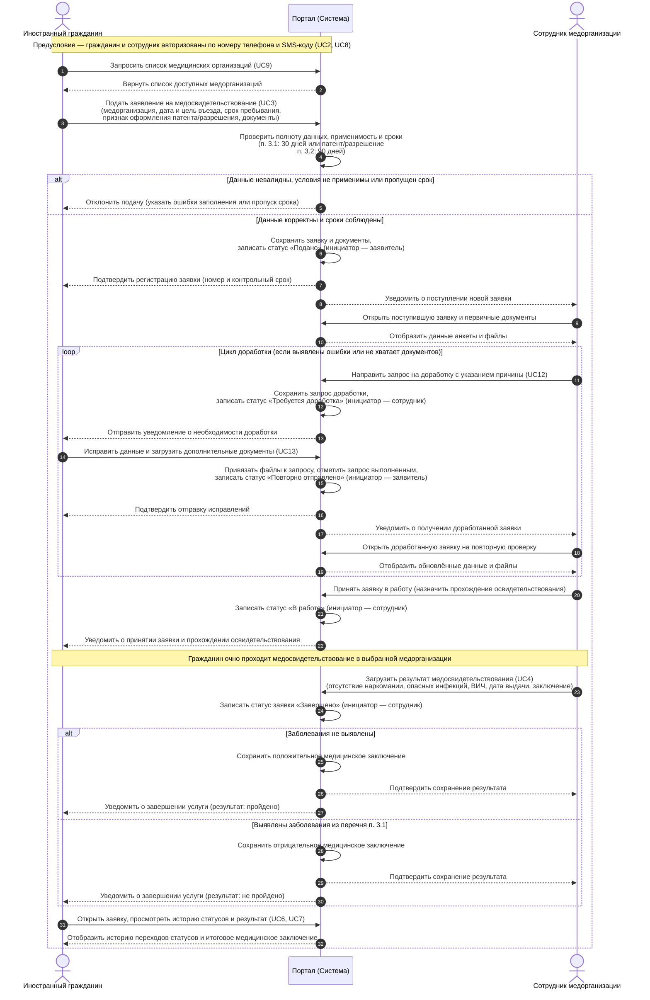

## 1. Выбранный прецедент (Use Case)

Для системной диаграммы последовательностей выбран сквозной сценарий **«Подача заявления и получение результата медицинского освидетельствования»** (пункты **3.1** и **3.2** раздела 3 дорожной карты)[cite: 10, 11]. Он раскрывает путь услуги от запроса до результата и объединяет связанные прецеденты из `use_case.md`:

- **UC3** — Подать заявление на медосвидетельствование (с обязательным включением **UC9** — Выбрать медицинскую организацию)[cite: 7].
- **UC12** — Запросить дополнительные документы или исправления (расширение `UC4`)[cite: 7].
- **UC13** — Дополнить заявление по запросу[cite: 7].
- **UC4** — Загрузить результат медосвидетельствования[cite: 7].
- **UC6** — Просмотреть статус и историю заявки[cite: 7].
- **UC7** — Получить результат медосвидетельствования[cite: 7].

## 2. Участники взаимодействия

Внутренние классы приложения на системной диаграмме не отображаются — система представлена как «чёрный ящик», взаимодействующий с внешними акторами из `use_case.md`[cite: 7, 10]:

| Участник | Роль в сценарии |
| :--- | :--- |
| **Иностранный гражданин** | Выбирает медорганизацию, подаёт заявление и документы, при необходимости дорабатывает заявку по запросу сотрудника, отслеживает историю статусов и получает итоговое заключение[cite: 7]. |
| **Портал (Система)** | «Портал медицинского освидетельствования и страхования»[cite: 7]. Проверяет корректность анкеты, применимость п. 3.1–3.2 и контрольные сроки, хранит заявки, документы, запросы доработки, историю статусов и результаты, рассылает уведомления[cite: 7, 8, 11]. |
| **Сотрудник медорганизации** | Проверяет комплектность документов, при необходимости запрашивает исправления, принимает заявку в работу и загружает итоговое медицинское заключение[cite: 7]. |

## 3. Описание этапов взаимодействия

**Предусловие:** иностранный гражданин и сотрудник медорганизации уже зарегистрированы и вошли в систему по номеру телефона и SMS-коду (`UC1`, `UC2`, `UC8`)[cite: 7, 10].

1. **Выбор организации и подача заявления (шаги 1–8):**
  - Гражданин запрашивает список медицинских организаций и выбирает нужную (`UC9`)[cite: 7].
  - Гражданин подаёт заявление (`UC3`), указывая дату и цель въезда, срок пребывания, признак обращения за патентом или разрешением на работу, и прикрепляет документы[cite: 7, 11].
  - Система проверяет корректность данных, применимость пунктов дорожной карты и контрольные сроки:
    - **п. 3.1** (цель въезда — трудовая деятельность): контрольный срок — **30 календарных дней со дня въезда** либо подача **при обращении с заявлением об оформлении патента или разрешения на работу**[cite: 11].
    - **п. 3.2** (иная цель въезда при пребывании **более 90 суток**): контрольный срок — **90 календарных дней со дня въезда**[cite: 11].
  - Ветвление `alt` прерывает сценарий, если поля заполнены с ошибками, не приложены обязательные файлы, условия применимости не выполнены или **заявитель пропустил разрешённый срок**. Система уведомляет гражданина о причине отказа[cite: 11].
  - При успешной проверке система сохраняет заявку, добавляет запись `«Подано»` в историю статусов (инициатор — заявитель) и уведомляет сотрудника медорганизации[cite: 8].
2. **Рассмотрение заявки и цикл доработки (шаги 9–20):**
  - Сотрудник медорганизации открывает поступившую заявку и осуществляет **первичную проверку** анкеты и файлов.
  - Если выявлены ошибки или нехватка документов (`UC12`), сотрудник запускает **цикл доработки** (`loop`), направляя запрос заявителю[cite: 7]. Система переводит заявку в статус `«Требуется доработка»` (инициатор — сотрудник). Гражданин вносит исправления и загружает файлы (`UC13`), после чего статус меняется на `«Повторно отправлено»` (инициатор — заявитель)[cite: 7, 8]. Сотрудник открывает заявку на **повторную проверку**.
  - Когда документы корректны (сразу после первичной проверки или после успешного завершения цикла доработки), сотрудник принимает заявку в работу (`«В работе»`).
3. **Загрузка результата медосвидетельствования (шаги 21–29):**
  - После очного обследования сотрудник вносит в систему результаты (`UC4`)[cite: 7].
  - Процесс оказания услуги завершён, поэтому система переводит заявку в финальный статус `«Завершено»` (инициатор — сотрудник)[cite: 8].
  - В зависимости от медицинских показателей формируется итоговый документ: при отсутствии заболеваний — **положительное заключение**, при выявлении заболеваний из перечня п. 3.1 — **отрицательное заключение**[cite: 8, 11]. Заявитель уведомляется о готовности результата.
4. **Просмотр истории и получение результата (шаги 30–31):**
  - Гражданин открывает заявку, просматривает полную историю переходов статусов (`UC6`) и получает итоговое медицинское заключение (`UC7`)[cite: 7].

## 4. Отражение сроков, возвратов и результатов

- **Проверка сроков:** на этапе подачи система строго валидирует соблюдение 30-дневного и 90-дневного срока; при их нарушении заявка отклоняется ещё до передачи в ведомство с указанием причины[cite: 11].
- **Возврат на исправление:** явно выделен в цикл повторных проверок через `UC12` / `UC13`, что соответствует сущности `REQUEST_FOR_DOCS` в ER-модели[cite: 7, 8].
- **Финальный результат:** статус рассмотрения заявки («Завершено») отделён от медицинского вердикта («Пройдено» / «Не пройдено»), что обеспечивает гибкость системы и корректно отражает завершение работы ведомства по обращению гражданина[cite: 8].
- **История статусов:** каждый переход в диаграмме соответствует записи в `STATUS_HISTORY` с явным указанием инициатора[cite: 8].