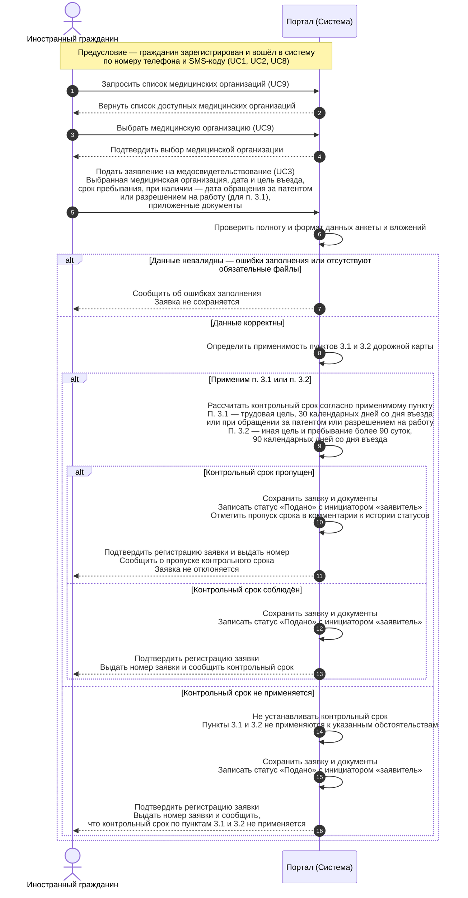

## 1. Выбранный прецедент

Для системной диаграммы последовательностей выбран один прецедент из `use_case.md`: **UC3 — Подать заявление на медосвидетельствование** с обязательным включением **UC9 — Выбрать медицинскую организацию**.

Диаграмма раскрывает взаимодействие иностранного гражданина с порталом от запроса списка медицинских организаций до получения результата подачи заявления.

Другие этапы оказания услуги в диаграмму не включены, поскольку относятся к самостоятельным прецедентам:
- **UC4** — Загрузить результат медосвидетельствования.
- **UC6** — Просмотреть статус и историю заявки.
- **UC7** — Получить результат медосвидетельствования.
- **UC12** — Запросить дополнительные документы или исправления.
- **UC13** — Дополнить заявление по запросу.

Успешная подача заявления завершается выдачей гражданину номера заявки. Последующее рассмотрение заявления и получение медицинского заключения находятся за пределами выбранного прецедента UC3.

## 2. Участники взаимодействия

На системной диаграмме портал представлен как «чёрный ящик», без отображения внутренних компонентов. Состав участников соответствует `use_case.md`.

| Участник | Роль в сценарии |
| :--- | :--- |
| **Иностранный гражданин** | Запрашивает список медицинских организаций, выбирает организацию, заполняет и подаёт заявление, получает результат подачи: список ошибок либо номер зарегистрированной заявки и информацию о контрольном сроке. |
| **Портал (Система)** | Возвращает список медицинских организаций, проверяет полноту и формат анкеты и вложений, определяет применимый пункт дорожной карты и контрольный срок, сохраняет заявку и документы, фиксирует начальный статус и выдаёт номер заявки. |

Сотрудник медицинской организации в данном сценарии не участвует. Его действия, включая загрузку медицинского заключения (UC4) и запрос исправлений (UC12), относятся к другим прецедентам и выполняются после подачи заявления.

## 3. Предусловие

Иностранный гражданин зарегистрирован и вошёл в систему по номеру телефона и SMS-коду. Это соответствует прецедентам **UC1 — Зарегистрироваться**, **UC2 — Войти в систему по телефону** и **UC8 — Подтвердить телефон SMS-кодом** из `use_case.md`.

## 4. Описание этапов взаимодействия

1. **Выбор медицинской организации (шаги 1–4).** Гражданин запрашивает список доступных медицинских организаций (UC9). Система возвращает список, после чего гражданин выбирает подходящую организацию. Система подтверждает выбор. Выбор медицинской организации является обязательным включением в UC3.

2. **Подача заявления (шаг 5).** Гражданин подаёт заявление на медицинское освидетельствование (UC3). В анкете указываются выбранная медицинская организация, дата и цель въезда, срок пребывания. Дата обращения за патентом или разрешением на работу указывается при наличии такого обращения (для случаев, предусмотренных п. 3.1 дорожной карты). Для заявителей, подпадающих под п. 3.2, это поле можно оставить пустым. К заявлению прикладываются необходимые документы.

3. **Проверка заполнения (шаг 6).** Система проверяет полноту и формат данных анкеты и приложенных файлов. На этом этапе проверяется корректность заполнения заявления, а не соблюдение контрольных сроков.

4. **Обработка ошибок заполнения (шаг 7).** Если в анкете обнаружены ошибки или отсутствуют обязательные файлы, система сообщает гражданину о выявленных проблемах. Заявка не сохраняется. Гражданин может исправить данные и отправить заявление повторно.

5. **Определение применимого пункта дорожной карты (шаги 8–9).** Если данные заполнены корректно, система определяет, распространяются ли на ситуацию заявителя условия пунктов 3.1 или 3.2:
   - **Пункт 3.1:** иностранный гражданин прибыл в Российскую Федерацию с целью осуществления трудовой деятельности. Срок обращения — в течение 30 календарных дней со дня въезда либо при обращении с заявлением об оформлении патента или разрешения на работу.
   - **Пункт 3.2:** иностранный гражданин прибыл на длительный период более 90 суток с целью, иной от осуществления трудовой деятельности. Срок обращения — в течение 90 календарных дней со дня въезда.

6. **Пропуск контрольного срока (шаги 10–11).** Если применимый контрольный срок пропущен, система не отклоняет заявление только по этой причине. Заявка и документы сохраняются, в истории статусов создаётся запись «Подано» с инициатором «заявитель», а в комментарии фиксируется пропуск контрольного срока. Гражданину выдаётся номер заявки и сообщается о пропуске срока.

7. **Соблюдение контрольного срока (шаги 12–13).** Если применимый контрольный срок соблюдён, система сохраняет заявку и приложенные документы, создаёт запись «Подано» в истории статусов с инициатором «заявитель» и подтверждает регистрацию. Гражданин получает номер заявки и информацию о контрольном сроке.

8. **Отсутствие применимого контрольного срока (шаги 14–16).** Если условия пунктов 3.1 и 3.2 не подходят под обстоятельства заявителя, система не устанавливает контрольный срок на основании этих пунктов. При этом заявка и документы сохраняются, создаётся запись «Подано» в истории статусов, а гражданин получает номер заявки и уведомление об отсутствии применимого контрольного срока по пунктам 3.1 и 3.2. Это не является отказом в регистрации заявления.

На этом прецедент UC3 завершается.

## 5. Отражение сроков и возвратов

- **Ошибки заполнения:** если анкета заполнена некорректно или отсутствуют обязательные файлы, система сообщает об ошибках и не сохраняет заявку. Гражданин может исправить данные и подать заявление повторно.
- **Пропуск контрольного срока:** если на заявителя распространяется пункт 3.1 или 3.2 дорожной карты, но контрольный срок пропущен, система сохраняет заявку, фиксирует факт пропуска срока и выдаёт гражданину номер заявки. Сам по себе пропуск срока не является основанием для отказа в регистрации заявления.
- **Соблюдение контрольного срока:** если срок, установленный применимым пунктом дорожной карты, соблюдён, система сохраняет заявку и возвращает гражданину номер заявки и информацию о контрольном сроке.
- **Отсутствие применимого контрольного срока:** если обстоятельства заявителя не соответствуют условиям пунктов 3.1 и 3.2, система не устанавливает срок на основании этих пунктов. Заявка при этом сохраняется, а гражданину выдаётся номер заявки.
- **История статусов:** при сохранении заявки создаётся первая запись в `STATUS_HISTORY` со статусом «Подано» и типом инициатора `applicant`. Если срок пропущен, соответствующая информация фиксируется в поле `comment`.